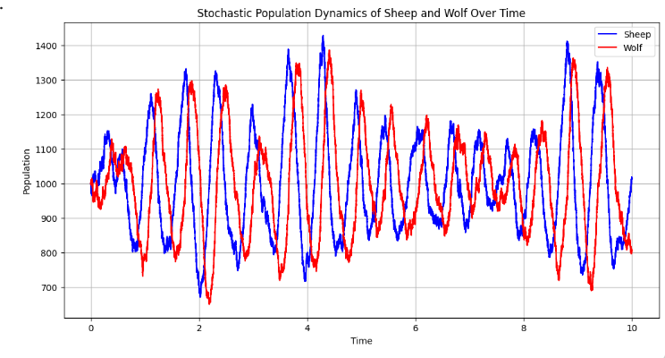
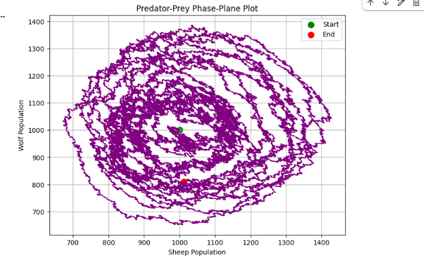
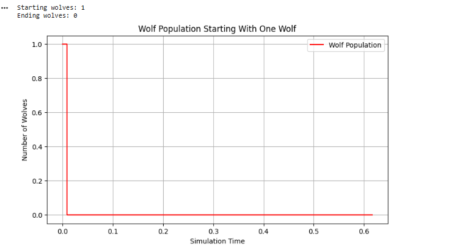
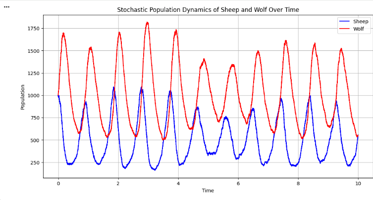

# NANO706 – Assignment 2

## Project Overview

This assignment explores computational modeling and simulation of biological systems. Python and Google Colab were used to investigate how changes in reaction parameters, stochastic events, and time delays affect system behavior.

## Exercise 1: Biological Modeling and Simulation

### Part 1: Predator–Prey Model

A stochastic Gillespie simulation was used to model interactions between sheep and wolves. Different initial populations and reaction parameters were tested to investigate population growth, predator–prey interactions, and extinction.

Additional population and phase-plane plots were generated to visualize the results.
#### Predator–Prey Population Over Time

**Results:** The sheep and wolf populations fluctuate throughout the simulation. Sheep population peaks generally occur before wolf population peaks, illustrating how predator growth responds to changes in prey availability.

#### Predator–Prey Phase-Plane Plot

**Results:** The phase-plane plot shows the relationship between sheep and wolf populations. The looping patterns indicate repeated population fluctuations, while the irregular trajectories reflect the stochastic nature of the simulation.
#### One-Wolf Extinction Experiment

**Initial conditions:** 1,000 sheep and 1 wolf.

**Printed results:**
- Starting wolves: 1
- Ending wolves: 0

**Interpretation:** The simulation began with one wolf, but its population quickly decreased to zero and remained extinct. This demonstrates how a small predator population can be vulnerable to stochastic extinction. In this simulation, the lone wolf died before successfully establishing a larger population.

**Conclusion:** The results suggest that very small initial predator populations may be less likely to survive because random events can cause extinction before reproduction occurs.
Reduced Wolf Starvation Rate (c_starve = 5)
#### Reduced Wolf Starvation Rate (`c_starve = 5`)

**Parameter changed:** The wolf starvation rate was reduced to `c_starve = 5`.

**Results:** The wolf population reached approximately 1,800 at its highest peak, while the sheep population peaked around 1,100. Both populations continued to experience repeated oscillations.

**Interpretation:** Reducing the wolf starvation rate allows wolves to survive longer, which can increase the wolf population and place greater predation pressure on sheep. The continued oscillations demonstrate how changes in predator mortality affect the balance between predator and prey populations.
### Part 2: Multi-Step Reactions

Multi-step reaction dynamics were compared with simplified models using mean reaction times and different delay distributions.

An additional production-rate graph was created to compare how quickly the final product accumulated over time.

### Part 3: Negative Feedback with Time Delay

A negative feedback system involving molecules A and B was simulated using three delay values: τ = 0, τ = 30, and τ = 50.

The simulations showed that increasing the feedback delay could produce larger and more pronounced oscillations. With no delay, the system displayed relatively small fluctuations after its initial adjustment.

## Tools Used

- Python
- Google Colab
- NumPy
- Matplotlib
- GitHub

## Project Status

Exercise 1 simulations and additional visualizations have been completed. Documentation, verification of assignment requirements, and Exercise 2 are still in progress.
